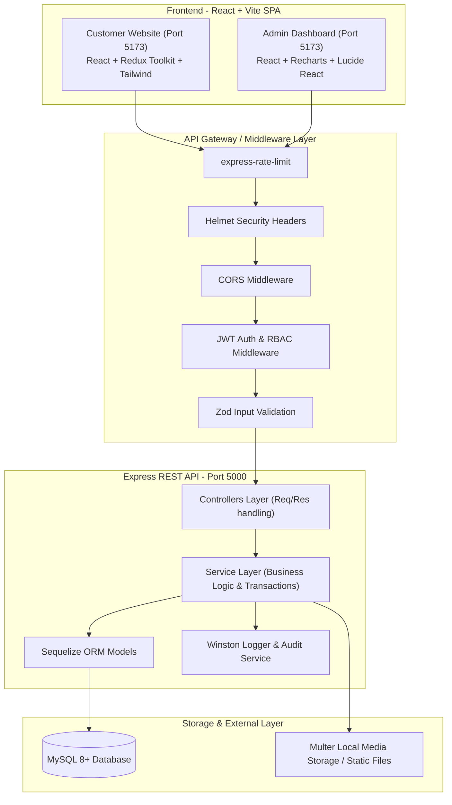

# ARCHITECTURE.md - Full-Stack Amazon-Inspired E-Commerce Platform

## 1. System Overview

This document defines the high-level architecture, component hierarchy, folder organization, security model, and data flow for the production-grade Amazon-inspired e-commerce platform.

The system follows a decoupled **Client-Server REST Architecture** with a **React SPA frontend**, **Node.js/Express.js RESTful API backend**, **Sequelize ORM**, and a **MySQL 8+ relational database**.



---

## 2. Tech Stack & Dependencies

### Frontend (`/client`)
- **Core**: React.js 18+, Vite
- **State Management**: Redux Toolkit (global cart, auth state, UI states, notifications)
- **Routing**: React Router v6+ (Client & Admin layout routes, protected route guards)
- **HTTP Client**: Axios (configured with request/response interceptors for JWT injection and token refresh/error handling)
- **Form & Validation**: React Hook Form, Zod validation schemas
- **Styling & UI**: Tailwind CSS, Lucide React icons
- **Data Visualization**: Recharts (Revenue, Orders, Low Stock analytics)

### Backend (`/server`)
- **Runtime & Framework**: Node.js v18+, Express.js
- **Database & ORM**: MySQL 8+, Sequelize ORM 6+
- **Security & Auth**: JSON Web Tokens (JWT), bcryptjs password hashing, Helmet security headers, CORS, express-rate-limit
- **Validation**: Zod (request body, params, query schemas)
- **File Management**: Multer (product and review image uploads)
- **Logging & Monitoring**: Winston logger (file + console streams, level-based logs, structured JSON format)

---

## 3. Directory & Folder Structure

```
CCCP_Amazon/
├── client/                     # React + Vite Frontend
│   ├── public/                 # Static assets (favicons, logos)
│   ├── src/
│   │   ├── assets/             # Images, placeholders, global styles
│   │   ├── components/         # Reusable UI components
│   │   │   ├── common/         # Buttons, Cards, Inputs, Modal, Loader, Badge, Toast, Pagination
│   │   │   ├── customer/       # Header, Footer, Navbar, ProductCard, CartItem, ReviewCard, StarRating
│   │   │   └── admin/          # AdminHeader, AdminSidebar, AnalyticsCard, DataTable, MetricWidget
│   │   ├── context/            # React contexts
│   │   ├── features/           # Redux Slices & Async Thunks
│   │   │   ├── auth/           # authSlice.js
│   │   │   ├── cart/           # cartSlice.js
│   │   │   ├── wishlist/       # wishlistSlice.js
│   │   │   ├── products/       # productSlice.js
│   │   │   ├── orders/         # orderSlice.js
│   │   │   ├── reviews/        # reviewSlice.js
│   │   │   ├── notifications/  # notificationSlice.js
│   │   │   └── admin/          # adminSlice.js
│   │   ├── hooks/              # Custom React hooks (useAuth, useCart, useDebounce, usePagination)
│   │   ├── layouts/            # MainLayout, CustomerLayout, AdminLayout, AuthLayout
│   │   ├── pages/              # Page components
│   │   │   ├── customer/       # Home, ProductList, ProductDetail, Cart, Wishlist, Checkout, Orders, OrderDetail, UserProfile, AddressManager, Returns, QuestionPage
│   │   │   └── admin/          # AdminDashboard, ProductsAdmin, ProductForm, CategoriesAdmin, InventoryAdmin, OrdersAdmin, CustomersAdmin, ModerationAdmin, CouponsAdmin, ReturnsAdmin, AuditLogsAdmin, SettingsAdmin
│   │   ├── routes/             # AppRoutes.jsx, ProtectedRoute.jsx, AdminRoute.jsx
│   │   ├── services/           # Axios API services (api.js, authApi.js, productApi.js, orderApi.js, etc.)
│   │   ├── utils/              # Formatter (currency, date), constants, storage helpers
│   │   ├── validators/         # Zod frontend validation schemas
│   │   ├── App.jsx             # App entry layout & router setup
│   │   └── main.jsx            # Entry point with Provider wrappers
│   ├── index.html
│   ├── package.json
│   ├── tailwind.config.js
│   └── vite.config.js
│
├── server/                     # Express.js REST API Backend
│   ├── config/                 # Configuration files
│   │   ├── database.js         # Sequelize instance & MySQL connection config
│   │   ├── env.js              # Enforced environment variables with Zod
│   │   └── logger.js           # Winston logger configuration
│   ├── src/
│   │   ├── controllers/        # Request handlers
│   │   │   ├── auth.controller.js
│   │   │   ├── user.controller.js
│   │   │   ├── address.controller.js
│   │   │   ├── category.controller.js
│   │   │   ├── product.controller.js
│   │   │   ├── cart.controller.js
│   │   │   ├── wishlist.controller.js
│   │   │   ├── order.controller.js
│   │   │   ├── payment.controller.js
│   │   │   ├── review.controller.js
│   │   │   ├── coupon.controller.js
│   │   │   ├── inventory.controller.js
│   │   │   ├── notification.controller.js
│   │   │   ├── return.controller.js
│   │   │   ├── question.controller.js
│   │   │   └── admin.controller.js
│   │   ├── middlewares/        # Custom Express middlewares
│   │   │   ├── auth.middleware.js       # JWT Verification
│   │   │   ├── rbac.middleware.js       # Role authorization (CUSTOMER, ADMIN, SUPER_ADMIN)
│   │   │   ├── validate.middleware.js   # Zod request validation wrapper
│   │   │   ├── error.middleware.js      # Global centralized error handler
│   │   │   ├── rateLimiter.middleware.js# General and sensitive endpoint limiters
│   │   │   └── upload.middleware.js     # Multer file upload setup
│   │   ├── models/             # Sequelize models & associations
│   │   │   ├── index.js                 # Export all models and define associations
│   │   │   ├── User.js
│   │   │   ├── Address.js
│   │   │   ├── Category.js
│   │   │   ├── Product.js
│   │   │   ├── ProductImage.js
│   │   │   ├── ProductVariant.js
│   │   │   ├── ProductAttribute.js
│   │   │   ├── Cart.js
│   │   │   ├── CartItem.js
│   │   │   ├── Wishlist.js
│   │   │   ├── WishlistItem.js
│   │   │   ├── Order.js
│   │   │   ├── OrderItem.js
│   │   │   ├── Payment.js
│   │   │   ├── Review.js
│   │   │   ├── ReviewImage.js
│   │   │   ├── Coupon.js
│   │   │   ├── CouponUsage.js
│   │   │   ├── Inventory.js
│   │   │   ├── InventoryTransaction.js
│   │   │   ├── Notification.js
│   │   │   ├── Return.js
│   │   │   ├── Refund.js
│   │   │   ├── ProductQuestion.js
│   │   │   ├── ProductAnswer.js
│   │   │   ├── RecentlyViewed.js
│   │   │   └── AuditLog.js
│   │   ├── routes/             # Express routes mounting controllers
│   │   │   ├── index.js        # Main route hub (/api/v1)
│   │   │   ├── auth.routes.js
│   │   │   ├── user.routes.js
│   │   │   ├── category.routes.js
│   │   │   ├── product.routes.js
│   │   │   ├── cart.routes.js
│   │   │   ├── wishlist.routes.js
│   │   │   ├── order.routes.js
│   │   │   ├── review.routes.js
│   │   │   ├── coupon.routes.js
│   │   │   ├── notification.routes.js
│   │   │   ├── return.routes.js
│   │   │   ├── question.routes.js
│   │   │   └── admin.routes.js
│   │   ├── services/           # Business logic layer & Database Transactions
│   │   │   ├── auth.service.js
│   │   │   ├── product.service.js
│   │   │   ├── cart.service.js
│   │   │   ├── checkout.service.js   # Order placement with atomic transactions & stock verification
│   │   │   ├── inventory.service.js  # Low/out-of-stock engine & log records
│   │   │   ├── analytics.service.js  # Aggregations for admin dashboard
│   │   │   ├── audit.service.js      # Audit log recorder
│   │   │   └── notification.service.js
│   │   ├── utils/              # Helper functions (jwt.js, response.js, errors.js)
│   │   └── validators/         # Zod schemas for request validation
│   ├── uploads/                # Local uploaded images directory
│   ├── logs/                   # Winston log files (error.log, combined.log)
│   ├── seeders/                # Seed script for initial DB populate
│   ├── .env.example
│   ├── package.json
│   └── server.js               # Application entry point
│
├── ARCHITECTURE.md
├── DATABASE.md
├── API.md
├── FEATURES.md
├── IMPLEMENTATION_PLAN.md
└── README.md
```

---

## 4. Security & Authentication Architecture

### 4.1 JWT Authentication & RBAC
- **Authentication**: JWT tokens signed with SHA-256 containing `userId`, `email`, and `role`. Expiration set to 24 hours.
- **Roles**:
  - `CUSTOMER`: Default role upon public registration. Can browse, manage profile/addresses, cart, wishlist, orders, reviews, questions, returns.
  - `ADMIN`: Assigned by Super Admin. Can view analytics, manage products, categories, inventory, orders, moderations, coupons, returns.
  - `SUPER_ADMIN`: Master role. Full control including admin creation, settings modification, system audit log viewing.

### 4.2 Security Safeguards
- **Password Hashing**: `bcryptjs` with salt round of 10. Passwords are never returned in queries (`attributes: { exclude: ['password'] }`).
- **Zero-Trust Pricing & Inventory**: Frontend submits product IDs and variant IDs during checkout. Backend fetches authoritative prices and stock directly from MySQL inside an isolated database transaction. Frontend prices/totals are strictly ignored.
- **Rate Limiting**:
  - Global API limiter: 100 requests per 15-minute window per IP.
  - Auth limiter (`/api/v1/auth/login`, `/api/v1/auth/register`): 5 requests per minute per IP.
- **HTTP Headers**: Helmet middleware automatically sets secure headers (`X-Frame-Options`, `X-XSS-Protection`, `Strict-Transport-Security`, `Content-Security-Policy`).
- **CORS Config**: Strictly restricts requests to frontend origin (`http://localhost:5173`).

---

## 5. Transaction & Data Consistency Architecture

All multi-step state mutations (e.g. Placing Orders, Processing Refunds, Inventory Stock Adjustments) are wrapped in **Sequelize Managed Transactions**:

```javascript
// Example Atomic Transaction Pattern in Checkout Service
const transaction = await sequelize.transaction();
try {
  // 1. Lock inventory rows FOR UPDATE
  // 2. Validate stock availability for all items
  // 3. Deduct stock from Inventory table & record InventoryTransaction
  // 4. Create Order and OrderItems
  // 5. Apply Coupon discount if present and update CouponUsage
  // 6. Create Payment record (mock successful payment status)
  // 7. Clear CartItems
  // 8. Trigger Out-of-Stock / Order notifications
  await transaction.commit();
} catch (error) {
  await transaction.rollback();
  throw error;
}
```

---

## 6. Error Handling & Standard API Response Structure

### 6.1 Standard API Response Schema

#### Success Response (HTTP 200 / 201)
```json
{
  "success": true,
  "message": "Order created successfully",
  "data": {
    "orderId": "ORD-2026-98124",
    "totalAmount": 149.99,
    "status": "PROCESSING"
  },
  "meta": {
    "page": 1,
    "limit": 10,
    "total": 1
  }
}
```

#### Error Response (HTTP 4xx / 5xx)
```json
{
  "success": false,
  "message": "Validation failed",
  "error": {
    "code": "VALIDATION_ERROR",
    "details": [
      {
        "field": "email",
        "message": "Invalid email address format"
      }
    ]
  }
}
```

### 6.2 Centralized Logging Strategy (Winston)
- `logs/error.log`: Captures all 500-level uncaught exceptions with full stack traces.
- `logs/combined.log`: Captures all incoming HTTP requests, route accesses, authentication failures, and transaction events.
- Structured JSON format with timestamps, correlation IDs, and HTTP method details.
