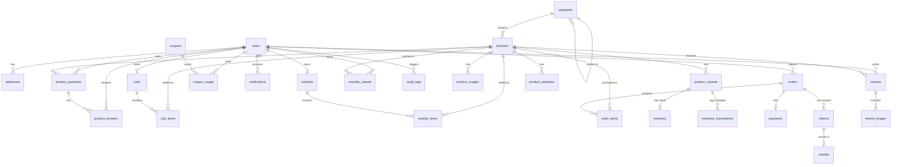

# DATABASE.md - Complete Database Schema & Entity Relationships

## 1. Overview & ER Diagram Overview

This document specifies the complete relational database schema for the MySQL 8+ database backing the Amazon-inspired e-commerce platform. The system comprises **27 database tables** managed via **Sequelize ORM**.



---

## 2. Table Specifications (27 Tables)

### 2.1 User & Auth Domain

#### 1. `users`
Stores user profile, credentials, and roles.
- `id`: `BIGINT UNSIGNED AUTO_INCREMENT PRIMARY KEY`
- `first_name`: `VARCHAR(50) NOT NULL`
- `last_name`: `VARCHAR(50) NOT NULL`
- `email`: `VARCHAR(150) NOT NULL UNIQUE` (Indexed)
- `phone`: `VARCHAR(20) NULL`
- `password`: `VARCHAR(255) NOT NULL` (bcrypt hashed)
- `role`: `ENUM('CUSTOMER', 'ADMIN', 'SUPER_ADMIN') NOT NULL DEFAULT 'CUSTOMER'`
- `is_active`: `BOOLEAN NOT NULL DEFAULT true`
- `last_login_at`: `DATETIME NULL`
- `created_at`: `DATETIME NOT NULL DEFAULT CURRENT_TIMESTAMP`
- `updated_at`: `DATETIME NOT NULL DEFAULT CURRENT_TIMESTAMP ON UPDATE CURRENT_TIMESTAMP`

#### 2. `addresses`
Shipping and billing addresses associated with users.
- `id`: `BIGINT UNSIGNED AUTO_INCREMENT PRIMARY KEY`
- `user_id`: `BIGINT UNSIGNED NOT NULL, FOREIGN KEY (users.id) ON DELETE CASCADE`
- `full_name`: `VARCHAR(100) NOT NULL`
- `street_address`: `VARCHAR(255) NOT NULL`
- `apartment_suite`: `VARCHAR(100) NULL`
- `city`: `VARCHAR(100) NOT NULL`
- `state`: `VARCHAR(100) NOT NULL`
- `postal_code`: `VARCHAR(20) NOT NULL`
- `country`: `VARCHAR(100) NOT NULL DEFAULT 'USA'`
- `phone`: `VARCHAR(20) NOT NULL`
- `is_default_shipping`: `BOOLEAN NOT NULL DEFAULT false`
- `is_default_billing`: `BOOLEAN NOT NULL DEFAULT false`
- `type`: `ENUM('SHIPPING', 'BILLING', 'BOTH') NOT NULL DEFAULT 'SHIPPING'`
- `created_at`, `updated_at`

---

### 2.2 Product Catalog Domain

#### 3. `categories`
Hierarchical product categories (supports unlimited nesting via parent_id).
- `id`: `BIGINT UNSIGNED AUTO_INCREMENT PRIMARY KEY`
- `name`: `VARCHAR(100) NOT NULL`
- `slug`: `VARCHAR(120) NOT NULL UNIQUE` (Indexed)
- `description`: `TEXT NULL`
- `image_url`: `VARCHAR(255) NULL`
- `parent_id`: `BIGINT UNSIGNED NULL, FOREIGN KEY (categories.id) ON DELETE SET NULL`
- `is_active`: `BOOLEAN NOT NULL DEFAULT true`
- `display_order`: `INT NOT NULL DEFAULT 0`
- `created_at`, `updated_at`

#### 4. `products`
Core product catalog table.
- `id`: `BIGINT UNSIGNED AUTO_INCREMENT PRIMARY KEY`
- `category_id`: `BIGINT UNSIGNED NOT NULL, FOREIGN KEY (categories.id) ON DELETE RESTRICT`
- `title`: `VARCHAR(255) NOT NULL` (FULLTEXT indexed with description)
- `slug`: `VARCHAR(280) NOT NULL UNIQUE` (Indexed)
- `sku`: `VARCHAR(100) NOT NULL UNIQUE`
- `brand`: `VARCHAR(100) NULL` (Indexed)
- `short_description`: `TEXT NULL`
- `description`: `LONGTEXT NOT NULL`
- `base_price`: `DECIMAL(10,2) NOT NULL`
- `sale_price`: `DECIMAL(10,2) NULL`
- `is_featured`: `BOOLEAN NOT NULL DEFAULT false`
- `is_active`: `BOOLEAN NOT NULL DEFAULT true`
- `average_rating`: `DECIMAL(3,2) NOT NULL DEFAULT 0.00`
- `total_reviews`: `INT UNSIGNED NOT NULL DEFAULT 0`
- `created_at`, `updated_at`

#### 5. `product_images`
Image gallery for products.
- `id`: `BIGINT UNSIGNED AUTO_INCREMENT PRIMARY KEY`
- `product_id`: `BIGINT UNSIGNED NOT NULL, FOREIGN KEY (products.id) ON DELETE CASCADE`
- `image_url`: `VARCHAR(255) NOT NULL`
- `alt_text`: `VARCHAR(150) NULL`
- `is_primary`: `BOOLEAN NOT NULL DEFAULT false`
- `display_order`: `INT NOT NULL DEFAULT 0`
- `created_at`, `updated_at`

#### 6. `product_variants`
SKU-level product variants (e.g. Size, Color, Capacity).
- `id`: `BIGINT UNSIGNED AUTO_INCREMENT PRIMARY KEY`
- `product_id`: `BIGINT UNSIGNED NOT NULL, FOREIGN KEY (products.id) ON DELETE CASCADE`
- `sku`: `VARCHAR(100) NOT NULL UNIQUE`
- `variant_name`: `VARCHAR(150) NOT NULL` (e.g. "Color: Black, Size: XL")
- `price`: `DECIMAL(10,2) NOT NULL`
- `stock_quantity`: `INT NOT NULL DEFAULT 0`
- `is_active`: `BOOLEAN NOT NULL DEFAULT true`
- `created_at`, `updated_at`

#### 7. `product_attributes`
Key-value technical specifications for products (e.g. Screen Size, Material, Weight).
- `id`: `BIGINT UNSIGNED AUTO_INCREMENT PRIMARY KEY`
- `product_id`: `BIGINT UNSIGNED NOT NULL, FOREIGN KEY (products.id) ON DELETE CASCADE`
- `attribute_key`: `VARCHAR(100) NOT NULL`
- `attribute_value`: `VARCHAR(255) NOT NULL`
- `created_at`, `updated_at`

---

### 2.3 Cart & Wishlist Domain

#### 8. `carts`
Shopping cart container per user.
- `id`: `BIGINT UNSIGNED AUTO_INCREMENT PRIMARY KEY`
- `user_id`: `BIGINT UNSIGNED NOT NULL UNIQUE, FOREIGN KEY (users.id) ON DELETE CASCADE`
- `created_at`, `updated_at`

#### 9. `cart_items`
Individual items inside a shopping cart.
- `id`: `BIGINT UNSIGNED AUTO_INCREMENT PRIMARY KEY`
- `cart_id`: `BIGINT UNSIGNED NOT NULL, FOREIGN KEY (carts.id) ON DELETE CASCADE`
- `product_id`: `BIGINT UNSIGNED NOT NULL, FOREIGN KEY (products.id) ON DELETE CASCADE`
- `variant_id`: `BIGINT UNSIGNED NULL, FOREIGN KEY (product_variants.id) ON DELETE SET NULL`
- `quantity`: `INT UNSIGNED NOT NULL DEFAULT 1`
- `created_at`, `updated_at`

#### 10. `wishlists`
Wishlist container per user.
- `id`: `BIGINT UNSIGNED AUTO_INCREMENT PRIMARY KEY`
- `user_id`: `BIGINT UNSIGNED NOT NULL UNIQUE, FOREIGN KEY (users.id) ON DELETE CASCADE`
- `created_at`, `updated_at`

#### 11. `wishlist_items`
Items saved in user wishlist.
- `id`: `BIGINT UNSIGNED AUTO_INCREMENT PRIMARY KEY`
- `wishlist_id`: `BIGINT UNSIGNED NOT NULL, FOREIGN KEY (wishlists.id) ON DELETE CASCADE`
- `product_id`: `BIGINT UNSIGNED NOT NULL, FOREIGN KEY (products.id) ON DELETE CASCADE`
- `created_at`, `updated_at`

---

### 2.4 Order & Payment Domain

#### 12. `orders`
Master order record.
- `id`: `BIGINT UNSIGNED AUTO_INCREMENT PRIMARY KEY`
- `order_number`: `VARCHAR(50) NOT NULL UNIQUE` (e.g. "ORD-20261001-9841")
- `user_id`: `BIGINT UNSIGNED NOT NULL, FOREIGN KEY (users.id) ON DELETE RESTRICT`
- `shipping_address_id`: `BIGINT UNSIGNED NULL, FOREIGN KEY (addresses.id) ON DELETE SET NULL`
- `billing_address_id`: `BIGINT UNSIGNED NULL, FOREIGN KEY (addresses.id) ON DELETE SET NULL`
- `shipping_address_snapshot`: `JSON NOT NULL` (Immutable copy of address at checkout)
- `subtotal_amount`: `DECIMAL(10,2) NOT NULL`
- `discount_amount`: `DECIMAL(10,2) NOT NULL DEFAULT 0.00`
- `shipping_fee`: `DECIMAL(10,2) NOT NULL DEFAULT 0.00`
- `tax_amount`: `DECIMAL(10,2) NOT NULL DEFAULT 0.00`
- `total_amount`: `DECIMAL(10,2) NOT NULL`
- `status`: `ENUM('PENDING', 'PROCESSING', 'SHIPPED', 'DELIVERED', 'CANCELLED', 'RETURNED') NOT NULL DEFAULT 'PENDING'`
- `tracking_number`: `VARCHAR(100) NULL`
- `carrier`: `VARCHAR(100) NULL`
- `placed_at`: `DATETIME NOT NULL DEFAULT CURRENT_TIMESTAMP`
- `shipped_at`: `DATETIME NULL`
- `delivered_at`: `DATETIME NULL`
- `created_at`, `updated_at`

#### 13. `order_items`
Line items attached to an order.
- `id`: `BIGINT UNSIGNED AUTO_INCREMENT PRIMARY KEY`
- `order_id`: `BIGINT UNSIGNED NOT NULL, FOREIGN KEY (orders.id) ON DELETE CASCADE`
- `product_id`: `BIGINT UNSIGNED NOT NULL, FOREIGN KEY (products.id) ON DELETE RESTRICT`
- `variant_id`: `BIGINT UNSIGNED NULL, FOREIGN KEY (product_variants.id) ON DELETE SET NULL`
- `product_name`: `VARCHAR(255) NOT NULL`
- `sku`: `VARCHAR(100) NOT NULL`
- `unit_price`: `DECIMAL(10,2) NOT NULL`
- `quantity`: `INT UNSIGNED NOT NULL`
- `subtotal`: `DECIMAL(10,2) NOT NULL`
- `created_at`, `updated_at`

#### 14. `payments`
Payment transaction processing details.
- `id`: `BIGINT UNSIGNED AUTO_INCREMENT PRIMARY KEY`
- `order_id`: `BIGINT UNSIGNED NOT NULL UNIQUE, FOREIGN KEY (orders.id) ON DELETE CASCADE`
- `payment_method`: `ENUM('CREDIT_CARD', 'DEBIT_CARD', 'PAYPAL', 'MOCK_GATEWAY') NOT NULL DEFAULT 'MOCK_GATEWAY'`
- `transaction_id`: `VARCHAR(100) NOT NULL UNIQUE`
- `amount`: `DECIMAL(10,2) NOT NULL`
- `status`: `ENUM('PENDING', 'SUCCESS', 'FAILED', 'REFUNDED') NOT NULL DEFAULT 'PENDING'`
- `payment_gateway_response`: `JSON NULL`
- `created_at`, `updated_at`

---

### 2.5 Inventory & Operations Domain

#### 15. `inventory`
Real-time stock level tracker linked to products and variants.
- `id`: `BIGINT UNSIGNED AUTO_INCREMENT PRIMARY KEY`
- `product_id`: `BIGINT UNSIGNED NOT NULL, FOREIGN KEY (products.id) ON DELETE CASCADE`
- `variant_id`: `BIGINT UNSIGNED NULL UNIQUE, FOREIGN KEY (product_variants.id) ON DELETE CASCADE`
- `stock_quantity`: `INT NOT NULL DEFAULT 0`
- `low_stock_threshold`: `INT NOT NULL DEFAULT 5`
- `reorder_point`: `INT NOT NULL DEFAULT 10`
- `created_at`, `updated_at`

#### 16. `inventory_transactions`
Audit trail of stock movements (sales, restocks, returns, adjustments).
- `id`: `BIGINT UNSIGNED AUTO_INCREMENT PRIMARY KEY`
- `inventory_id`: `BIGINT UNSIGNED NOT NULL, FOREIGN KEY (inventory.id) ON DELETE CASCADE`
- `quantity_change`: `INT NOT NULL` (Positive for restock/return, negative for sale)
- `type`: `ENUM('PURCHASE', 'RESTOCK', 'RETURN_RESTOCK', 'ADJUSTMENT', 'DAMAGE') NOT NULL`
- `reference_id`: `VARCHAR(100) NULL` (e.g. Order # or Admin Ref)
- `performed_by`: `BIGINT UNSIGNED NULL, FOREIGN KEY (users.id) ON DELETE SET NULL`
- `notes`: `VARCHAR(255) NULL`
- `created_at`

---

### 2.6 Reviews, Q&A, Coupons & Customer Engagement Domain

#### 17. `reviews`
Customer reviews and star ratings for products.
- `id`: `BIGINT UNSIGNED AUTO_INCREMENT PRIMARY KEY`
- `product_id`: `BIGINT UNSIGNED NOT NULL, FOREIGN KEY (products.id) ON DELETE CASCADE`
- `user_id`: `BIGINT UNSIGNED NOT NULL, FOREIGN KEY (users.id) ON DELETE CASCADE`
- `rating`: `TINYINT UNSIGNED NOT NULL` (1 to 5)
- `title`: `VARCHAR(150) NOT NULL`
- `comment`: `TEXT NOT NULL`
- `is_verified_purchase`: `BOOLEAN NOT NULL DEFAULT false`
- `status`: `ENUM('PENDING', 'APPROVED', 'REJECTED') NOT NULL DEFAULT 'APPROVED'`
- `created_at`, `updated_at`

#### 18. `review_images`
Images uploaded alongside customer reviews.
- `id`: `BIGINT UNSIGNED AUTO_INCREMENT PRIMARY KEY`
- `review_id`: `BIGINT UNSIGNED NOT NULL, FOREIGN KEY (reviews.id) ON DELETE CASCADE`
- `image_url`: `VARCHAR(255) NOT NULL`
- `created_at`

#### 19. `coupons`
Discount codes and promotional rules.
- `id`: `BIGINT UNSIGNED AUTO_INCREMENT PRIMARY KEY`
- `code`: `VARCHAR(50) NOT NULL UNIQUE`
- `discount_type`: `ENUM('PERCENTAGE', 'FIXED_AMOUNT') NOT NULL`
- `discount_value`: `DECIMAL(10,2) NOT NULL`
- `minimum_order_amount`: `DECIMAL(10,2) NOT NULL DEFAULT 0.00`
- `max_discount_amount`: `DECIMAL(10,2) NULL`
- `start_date`: `DATETIME NOT NULL`
- `end_date`: `DATETIME NOT NULL`
- `usage_limit`: `INT UNSIGNED NULL`
- `usage_count`: `INT UNSIGNED NOT NULL DEFAULT 0`
- `is_active`: `BOOLEAN NOT NULL DEFAULT true`
- `created_at`, `updated_at`

#### 20. `coupon_usage`
Tracking which users have redeemed specific coupons.
- `id`: `BIGINT UNSIGNED AUTO_INCREMENT PRIMARY KEY`
- `coupon_id`: `BIGINT UNSIGNED NOT NULL, FOREIGN KEY (coupons.id) ON DELETE CASCADE`
- `user_id`: `BIGINT UNSIGNED NOT NULL, FOREIGN KEY (users.id) ON DELETE CASCADE`
- `order_id`: `BIGINT UNSIGNED NOT NULL, FOREIGN KEY (orders.id) ON DELETE CASCADE`
- `used_at`: `DATETIME NOT NULL DEFAULT CURRENT_TIMESTAMP`

#### 21. `product_questions`
Customer-asked questions on product pages.
- `id`: `BIGINT UNSIGNED AUTO_INCREMENT PRIMARY KEY`
- `product_id`: `BIGINT UNSIGNED NOT NULL, FOREIGN KEY (products.id) ON DELETE CASCADE`
- `user_id`: `BIGINT UNSIGNED NOT NULL, FOREIGN KEY (users.id) ON DELETE CASCADE`
- `question`: `TEXT NOT NULL`
- `is_answered`: `BOOLEAN NOT NULL DEFAULT false`
- `created_at`, `updated_at`

#### 22. `product_answers`
Answers provided by sellers/admins or verified customers.
- `id`: `BIGINT UNSIGNED AUTO_INCREMENT PRIMARY KEY`
- `question_id`: `BIGINT UNSIGNED NOT NULL, FOREIGN KEY (product_questions.id) ON DELETE CASCADE`
- `user_id`: `BIGINT UNSIGNED NOT NULL, FOREIGN KEY (users.id) ON DELETE CASCADE`
- `answer`: `TEXT NOT NULL`
- `is_admin_answer`: `BOOLEAN NOT NULL DEFAULT false`
- `created_at`, `updated_at`

#### 23. `recently_viewed`
Tracks products recently viewed by logged-in users.
- `id`: `BIGINT UNSIGNED AUTO_INCREMENT PRIMARY KEY`
- `user_id`: `BIGINT UNSIGNED NOT NULL, FOREIGN KEY (users.id) ON DELETE CASCADE`
- `product_id`: `BIGINT UNSIGNED NOT NULL, FOREIGN KEY (products.id) ON DELETE CASCADE`
- `viewed_at`: `DATETIME NOT NULL DEFAULT CURRENT_TIMESTAMP ON UPDATE CURRENT_TIMESTAMP`

#### 24. `notifications`
System alerts and notifications for customers and admins.
- `id`: `BIGINT UNSIGNED AUTO_INCREMENT PRIMARY KEY`
- `user_id`: `BIGINT UNSIGNED NOT NULL, FOREIGN KEY (users.id) ON DELETE CASCADE`
- `title`: `VARCHAR(150) NOT NULL`
- `message`: `TEXT NOT NULL`
- `type`: `ENUM('ORDER_STATUS', 'LOW_STOCK', 'OUT_OF_STOCK', 'PRICE_DROP', 'SYSTEM') NOT NULL`
- `is_read`: `BOOLEAN NOT NULL DEFAULT false`
- `link`: `VARCHAR(255) NULL`
- `created_at`

---

### 2.7 Returns, Refunds & Audit Domain

#### 25. `returns`
Return requests initiated by customers.
- `id`: `BIGINT UNSIGNED AUTO_INCREMENT PRIMARY KEY`
- `order_id`: `BIGINT UNSIGNED NOT NULL, FOREIGN KEY (orders.id) ON DELETE RESTRICT`
- `user_id`: `BIGINT UNSIGNED NOT NULL, FOREIGN KEY (users.id) ON DELETE CASCADE`
- `reason`: `VARCHAR(255) NOT NULL`
- `details`: `TEXT NULL`
- `status`: `ENUM('REQUESTED', 'APPROVED', 'REJECTED', 'ITEM_RECEIVED', 'COMPLETED') NOT NULL DEFAULT 'REQUESTED'`
- `created_at`, `updated_at`

#### 26. `refunds`
Refund financial records tied to approved return requests.
- `id`: `BIGINT UNSIGNED AUTO_INCREMENT PRIMARY KEY`
- `return_id`: `BIGINT UNSIGNED NOT NULL UNIQUE, FOREIGN KEY (returns.id) ON DELETE CASCADE`
- `order_id`: `BIGINT UNSIGNED NOT NULL, FOREIGN KEY (orders.id) ON DELETE RESTRICT`
- `amount`: `DECIMAL(10,2) NOT NULL`
- `status`: `ENUM('PENDING', 'PROCESSED', 'FAILED') NOT NULL DEFAULT 'PENDING'`
- `processed_by`: `BIGINT UNSIGNED NULL, FOREIGN KEY (users.id) ON DELETE SET NULL`
- `transaction_reference`: `VARCHAR(100) NULL`
- `created_at`, `updated_at`

#### 27. `audit_logs`
System activity log tracking admin & system operations.
- `id`: `BIGINT UNSIGNED AUTO_INCREMENT PRIMARY KEY`
- `user_id`: `BIGINT UNSIGNED NULL, FOREIGN KEY (users.id) ON DELETE SET NULL`
- `action`: `VARCHAR(100) NOT NULL` (e.g. "UPDATE_PRODUCT_PRICE", "APPROVE_REFUND")
- `entity_type`: `VARCHAR(50) NOT NULL` (e.g. "PRODUCT", "ORDER", "USER")
- `entity_id`: `BIGINT UNSIGNED NULL`
- `old_values`: `JSON NULL`
- `new_values`: `JSON NULL`
- `ip_address`: `VARCHAR(45) NULL`
- `user_agent`: `VARCHAR(255) NULL`
- `created_at`

---

## 3. Sequelize Relationships Setup (`server/src/models/index.js`)

```javascript
// User relationships
User.hasMany(Address, { foreignKey: 'user_id', as: 'addresses' });
Address.belongsTo(User, { foreignKey: 'user_id' });

User.hasOne(Cart, { foreignKey: 'user_id', as: 'cart' });
Cart.belongsTo(User, { foreignKey: 'user_id' });

User.hasOne(Wishlist, { foreignKey: 'user_id', as: 'wishlist' });
Wishlist.belongsTo(User, { foreignKey: 'user_id' });

User.hasMany(Order, { foreignKey: 'user_id', as: 'orders' });
Order.belongsTo(User, { foreignKey: 'user_id' });

// Category & Product relationships
Category.hasMany(Category, { foreignKey: 'parent_id', as: 'subcategories' });
Category.belongsTo(Category, { foreignKey: 'parent_id', as: 'parent' });

Category.hasMany(Product, { foreignKey: 'category_id', as: 'products' });
Product.belongsTo(Category, { foreignKey: 'category_id', as: 'category' });

Product.hasMany(ProductImage, { foreignKey: 'product_id', as: 'images' });
ProductImage.belongsTo(Product, { foreignKey: 'product_id' });

Product.hasMany(ProductVariant, { foreignKey: 'product_id', as: 'variants' });
ProductVariant.belongsTo(Product, { foreignKey: 'product_id' });

Product.hasMany(ProductAttribute, { foreignKey: 'product_id', as: 'attributes' });
ProductAttribute.belongsTo(Product, { foreignKey: 'product_id' });

// Cart & Wishlist items
Cart.hasMany(CartItem, { foreignKey: 'cart_id', as: 'items' });
CartItem.belongsTo(Cart, { foreignKey: 'cart_id' });
CartItem.belongsTo(Product, { foreignKey: 'product_id', as: 'product' });
CartItem.belongsTo(ProductVariant, { foreignKey: 'variant_id', as: 'variant' });

Wishlist.hasMany(WishlistItem, { foreignKey: 'wishlist_id', as: 'items' });
WishlistItem.belongsTo(Wishlist, { foreignKey: 'wishlist_id' });
WishlistItem.belongsTo(Product, { foreignKey: 'product_id', as: 'product' });

// Order relationships
Order.hasMany(OrderItem, { foreignKey: 'order_id', as: 'items' });
OrderItem.belongsTo(Order, { foreignKey: 'order_id' });
OrderItem.belongsTo(Product, { foreignKey: 'product_id', as: 'product' });

Order.hasOne(Payment, { foreignKey: 'order_id', as: 'payment' });
Payment.belongsTo(Order, { foreignKey: 'order_id' });

Order.hasMany(Return, { foreignKey: 'order_id', as: 'returns' });
Return.belongsTo(Order, { foreignKey: 'order_id' });

Return.hasOne(Refund, { foreignKey: 'return_id', as: 'refund' });
Refund.belongsTo(Return, { foreignKey: 'return_id' });

// Reviews & Q&A
Product.hasMany(Review, { foreignKey: 'product_id', as: 'reviews' });
Review.belongsTo(Product, { foreignKey: 'product_id' });
Review.belongsTo(User, { foreignKey: 'user_id', as: 'author' });

Review.hasMany(ReviewImage, { foreignKey: 'review_id', as: 'images' });
ReviewImage.belongsTo(Review, { foreignKey: 'review_id' });

Product.hasMany(ProductQuestion, { foreignKey: 'product_id', as: 'questions' });
ProductQuestion.belongsTo(Product, { foreignKey: 'product_id' });
ProductQuestion.belongsTo(User, { foreignKey: 'user_id', as: 'asker' });

ProductQuestion.hasMany(ProductAnswer, { foreignKey: 'question_id', as: 'answers' });
ProductAnswer.belongsTo(ProductQuestion, { foreignKey: 'question_id' });
ProductAnswer.belongsTo(User, { foreignKey: 'user_id', as: 'answerer' });

// Inventory tracking
Product.hasOne(Inventory, { foreignKey: 'product_id', as: 'inventory' });
Inventory.belongsTo(Product, { foreignKey: 'product_id' });

ProductVariant.hasOne(Inventory, { foreignKey: 'variant_id', as: 'inventory' });
Inventory.belongsTo(ProductVariant, { foreignKey: 'variant_id' });

Inventory.hasMany(InventoryTransaction, { foreignKey: 'inventory_id', as: 'transactions' });
InventoryTransaction.belongsTo(Inventory, { foreignKey: 'inventory_id' });
```
