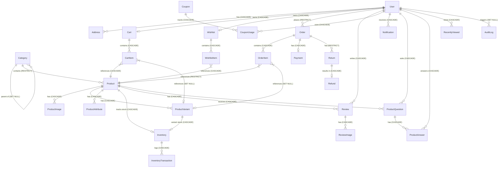

# IMPLEMENTATION_PLAN.md - Production-Style Amazon-Inspired Full-Stack E-Commerce Platform

---

## 1. Executive Summary & Architecture Overview

This document specifies the exhaustive, production-quality implementation plan for building a full-stack Amazon-inspired e-commerce platform. It is engineered for deterministic execution by an AI coding agent or senior engineering team.

### 1.1 Technology Stack & Architecture
- **Frontend**: React 18, Vite, JavaScript (ES6+), Redux Toolkit, React Router v6, Tailwind CSS, Lucide React, Axios, React Hook Form, Zod, Recharts.
- **Backend Architecture**: Node.js, Express.js (Layered Architecture: `Routes` → `Middlewares` → `Controllers` → `Services` → `Models` / Sequelize ORM).
- **Database & ORM**: MySQL 8+, Sequelize ORM 6+.
- **Authentication & Security**: JWT (Bearer tokens in HTTP headers), bcryptjs password hashing (salt round 10), Helmet security headers, CORS, express-rate-limit, Zod input validation, zero-trust server pricing/stock recalculation.
- **File Management**: Multer handling multipart uploads to `/server/uploads` (abstracted via storage service for future S3/Cloudinary compatibility), file type/size validation.
- **Mock Payment Gateway**: Pure server-side payment simulation engine supporting success/failure test scenarios without external SDK dependencies.
- **Logging & Auditing**: Winston structured JSON logging (file + console streams), immutable DB-persisted `AuditLog` table for administrative operations.

---

## 2. Complete Database Model Audit (27 Models)

The system is backed by **27 Sequelize models** with explicit primary keys, foreign key constraints, indexes, cascade behaviors, and relationships.



### 2.1 Model Specifications Matrix

| # | Model Name | Primary Key | Key Foreign Keys & Constraints | Indexes | On Delete Behavior |
|---|---|---|---|---|---|
| 1 | `User` | `id` (BIGINT) | Unique `email` | `idx_users_email`, `idx_users_role` | N/A |
| 2 | `Address` | `id` (BIGINT) | `user_id` (FK → User) | `idx_addresses_user_id` | CASCADE |
| 3 | `Category` | `id` (BIGINT) | `parent_id` (FK → Category), Unique `slug` | `idx_categories_slug`, `idx_categories_parent` | SET NULL |
| 4 | `Product` | `id` (BIGINT) | `category_id` (FK → Category), Unique `slug`, Unique `sku` | `idx_products_slug`, `idx_products_category`, Fulltext(`title`, `description`) | RESTRICT (Category) |
| 5 | `ProductImage` | `id` (BIGINT) | `product_id` (FK → Product) | `idx_product_images_product` | CASCADE |
| 6 | `ProductVariant` | `id` (BIGINT) | `product_id` (FK → Product), Unique `sku` | `idx_variants_product`, `idx_variants_sku` | CASCADE |
| 7 | `ProductAttribute` | `id` (BIGINT) | `product_id` (FK → Product) | `idx_attributes_product` | CASCADE |
| 8 | `Cart` | `id` (BIGINT) | Unique `user_id` (FK → User) | `idx_carts_user` | CASCADE |
| 9 | `CartItem` | `id` (BIGINT) | `cart_id` (FK → Cart), `product_id` (FK → Product), `variant_id` (FK → Variant). Unique(`cart_id`, `product_id`, `variant_id`) | `idx_cart_items_cart` | CASCADE (Cart/Product), SET NULL (Variant) |
| 10 | `Wishlist` | `id` (BIGINT) | Unique `user_id` (FK → User) | `idx_wishlists_user` | CASCADE |
| 11 | `WishlistItem` | `id` (BIGINT) | `wishlist_id` (FK → Wishlist), `product_id` (FK → Product). Unique(`wishlist_id`, `product_id`) | `idx_wishlist_items_wishlist` | CASCADE |
| 12 | `Order` | `id` (BIGINT) | Unique `order_number`, `user_id` (FK → User), `shipping_address_id`, `billing_address_id` | `idx_orders_user`, `idx_orders_number`, `idx_orders_status` | RESTRICT (User), SET NULL (Address) |
| 13 | `OrderItem` | `id` (BIGINT) | `order_id` (FK → Order), `product_id` (FK → Product), `variant_id` (FK → Variant) | `idx_order_items_order` | CASCADE (Order), RESTRICT (Product) |
| 14 | `Payment` | `id` (BIGINT) | Unique `order_id` (FK → Order), Unique `transaction_id` | `idx_payments_order`, `idx_payments_txn` | CASCADE |
| 15 | `Inventory` | `id` (BIGINT) | `product_id` (FK → Product), `variant_id` (FK → Variant). Unique(`product_id`, `variant_id`) | `idx_inventory_product_variant` | CASCADE |
| 16 | `InventoryTransaction` | `id` (BIGINT) | `inventory_id` (FK → Inventory), `performed_by` (FK → User) | `idx_inv_txn_inventory` | CASCADE (Inventory), SET NULL (User) |
| 17 | `Review` | `id` (BIGINT) | `product_id` (FK → Product), `user_id` (FK → User). Unique(`product_id`, `user_id`) | `idx_reviews_product_user` | CASCADE |
| 18 | `ReviewImage` | `id` (BIGINT) | `review_id` (FK → Review) | `idx_review_images_review` | CASCADE |
| 19 | `Coupon` | `id` (BIGINT) | Unique `code` | `idx_coupons_code`, `idx_coupons_dates` | N/A |
| 20 | `CouponUsage` | `id` (BIGINT) | `coupon_id` (FK → Coupon), `user_id` (FK → User), `order_id` (FK → Order) | `idx_coupon_usage_coupon_user` | CASCADE |
| 21 | `ProductQuestion` | `id` (BIGINT) | `product_id` (FK → Product), `user_id` (FK → User) | `idx_questions_product` | CASCADE |
| 22 | `ProductAnswer` | `id` (BIGINT) | `question_id` (FK → ProductQuestion), `user_id` (FK → User) | `idx_answers_question` | CASCADE |
| 23 | `RecentlyViewed` | `id` (BIGINT) | `user_id` (FK → User), `product_id` (FK → Product). Unique(`user_id`, `product_id`) | `idx_recently_viewed_user` | CASCADE |
| 24 | `Notification` | `id` (BIGINT) | `user_id` (FK → User) | `idx_notifications_user_read` | CASCADE |
| 25 | `Return` | `id` (BIGINT) | `order_id` (FK → Order), `user_id` (FK → User) | `idx_returns_order`, `idx_returns_status` | RESTRICT (Order), CASCADE (User) |
| 26 | `Refund` | `id` (BIGINT) | Unique `return_id` (FK → Return), `order_id` (FK → Order), `processed_by` (FK → User) | `idx_refunds_return` | CASCADE (Return), RESTRICT (Order) |
| 27 | `AuditLog` | `id` (BIGINT) | `user_id` (FK → User) | `idx_audit_logs_action`, `idx_audit_logs_created` | SET NULL |

---

## 3. Role-Based Access Control (RBAC) Matrix

Permissions are strictly enforced at the backend REST API level via `auth.middleware.js` and `rbac.middleware.js`. Frontend guards (`ProtectedRoute.jsx`, `AdminRoute.jsx`) serve exclusively as UI hints.

| Operational Feature | Public | CUSTOMER | ADMIN | SUPER_ADMIN |
|---|:---:|:---:|:---:|:---:|
| Browse Catalog / Search Products / Categories | ✅ | ✅ | ✅ | ✅ |
| View Product Reviews & Q&A | ✅ | ✅ | ✅ | ✅ |
| User Registration / Login | ✅ | ✅ | ✅ | ✅ |
| Manage Profile & Shipping Addresses | ❌ | ✅ | ✅ | ✅ |
| Manage Cart & Wishlist | ❌ | ✅ | ❌ | ❌ |
| Place Order / Apply Coupon / Mock Checkout | ❌ | ✅ | ❌ | ❌ |
| View Own Order History & Tracking | ❌ | ✅ | ❌ | ❌ |
| Request Return / Cancel Pending Order | ❌ | ✅ | ❌ | ❌ |
| Submit Review / Upload Review Image / Ask Question | ❌ | ✅ | ❌ | ❌ |
| View Admin Dashboard Analytics & Recharts | ❌ | ❌ | ✅ | ✅ |
| Product & Category CRUD / Variant Management | ❌ | ❌ | ✅ | ✅ |
| Inventory Adjustments (with mandatory reason log) | ❌ | ❌ | ✅ | ✅ |
| Order Status Fulfillment & Carrier Tracking Update | ❌ | ❌ | ✅ | ✅ |
| Moderate Reviews / Answer Product Questions | ❌ | ❌ | ✅ | ✅ |
| Process Returns & Issue Refunds | ❌ | ❌ | ✅ | ✅ |
| Manage Coupons & Discount Rules | ❌ | ❌ | ✅ | ✅ |
| Manage Customer Account Status (Activate/Deactivate) | ❌ | ❌ | ✅ | ✅ |
| View Immutable Audit Logs (`/admin/audit-logs`) | ❌ | ❌ | ❌ | ✅ |
| Manage System Settings & Admin Provisioning | ❌ | ❌ | ❌ | ✅ |

---

## 4. Detailed Phased Implementation Roadmap

---

### Phase 1: Foundation, Infrastructure, DB Schema, Auth & RBAC

#### 1. Prerequisites
- Node.js v18+, MySQL 8+ service running locally on port 3306.

#### 2. Files & Folders to Create/Modify
- `server/package.json`, `client/package.json`
- `server/config/database.js`, `server/config/env.js`, `server/config/logger.js`
- `server/src/models/index.js` and all 27 model files (`User.js`, `Address.js`, ..., `AuditLog.js`)
- `server/src/middlewares/auth.middleware.js`, `rbac.middleware.js`, `validate.middleware.js`, `error.middleware.js`, `rateLimiter.middleware.js`
- `server/src/controllers/auth.controller.js` & `server/src/services/auth.service.js`
- `server/src/validators/auth.validator.js`
- `server/seeders/seed.js`
- `client/src/features/auth/authSlice.js`, `client/src/services/api.js`, `client/src/services/authApi.js`
- `client/src/routes/AppRoutes.jsx`, `ProtectedRoute.jsx`, `AdminRoute.jsx`

#### 3. Database Work
- Define all 27 Sequelize models with exact types, indexes, unique constraints, and associations (`hasMany`, `belongsTo`, `hasOne`).
- Verify model initialization sync script in `server/src/models/index.js`.

#### 4. Backend Work
- Express server initialization with `helmet()`, `cors({ origin: 'http://localhost:5173' })`, `express.json()`.
- Auth Controller & Service handling:
  - `POST /api/v1/auth/register`: Password hashing with `bcryptjs` (salt round 10). Auto-creates empty `Cart` and `Wishlist` for new customers in a transaction.
  - `POST /api/v1/auth/login`: Validates credentials, issues JWT (24h expiry) containing `id`, `email`, `role`.
  - `GET /api/v1/auth/me`: Returns current authenticated user profile without password hash.
- Middleware setup:
  - `auth.middleware.js`: Verifies JWT header `Authorization: Bearer <token>`.
  - `rbac.middleware.js`: Restricts endpoint access by checking `req.user.role` against allowed roles.
  - `validate.middleware.js`: Wraps Zod validation schemas for `body`, `query`, `params`.
  - `error.middleware.js`: Catches errors, logs stack trace via Winston, returns uniform error envelope `{ success: false, message, error: { code, details } }`.

#### 5. Frontend Work
- Initialize Vite React SPA with Tailwind CSS and Lucide React.
- Set up Redux Toolkit store with `authSlice.js` handling token storage in `localStorage` and header injection in Axios.
- Set up React Router with layout routes and protected route guards (`ProtectedRoute`, `AdminRoute`).
- Build Auth UI pages (`Login.jsx`, `Register.jsx`).

#### 6. API Endpoints Specification

| Method | Endpoint | Auth | Role | Zod Request Body | Success Code |
|---|---|---|---|---|---|
| `POST` | `/api/v1/auth/register` | Public | None | `{ firstName, lastName, email, password, phone }` | `201 Created` |
| `POST` | `/api/v1/auth/login` | Public | None | `{ email, password }` | `200 OK` |
| `GET` | `/api/v1/auth/me` | Bearer | Any | None | `200 OK` |

#### 7. Business Rules & Edge Cases
- Passwords must be at least 8 characters, containing upper, lower, digit, and special char.
- Duplicate email registration yields `409 Conflict`.
- User accounts marked `is_active: false` cannot authenticate.

#### 8. Verification & Testing Commands
- Seed database: `cd server && node seeders/seed.js`
- Execute automated auth test suite: `cd server && npm test tests/auth.test.js`

#### 9. Definition of Done (DoD)
- Database creates all 27 tables cleanly.
- Super Admin (`superadmin@amazon.com`), Admin (`admin@amazon.com`), and Customer (`customer@amazon.com`) accounts are successfully seeded.
- Registration and login issue valid JWTs, and RBAC blocks unauthorized role requests with `403 Forbidden`.

---

### Phase 2: Product Catalog, Categories, Search, Filters & Inventory Engine

#### 1. Prerequisites
- Phase 1 completed (DB models and seed data available).

#### 2. Files & Folders to Create/Modify
- `server/src/controllers/category.controller.js`, `product.controller.js`
- `server/src/services/product.service.js`, `category.service.js`
- `server/src/validators/product.validator.js`
- `server/src/routes/category.routes.js`, `product.routes.js`
- `client/src/features/products/productSlice.js`
- `client/src/pages/customer/ProductList.jsx`, `ProductDetail.jsx`
- `client/src/components/customer/Header.jsx`, `Navbar.jsx`, `FilterSidebar.jsx`, `ProductCard.jsx`, `Pagination.jsx`

#### 3. Database Work
- Verify FULLTEXT index on `Product(title, description)`.
- Verify composite indexes on `Product(category_id, is_active, base_price)` and `ProductVariant(product_id, sku)`.

#### 4. Backend Work
- Build `GET /api/v1/categories`: Returns full category tree with nested subcategories (`parent_id`).
- Build `GET /api/v1/products`: Implements multi-facet filtering and search using MySQL query generation:
  - Keyword search via `Op.like` or FULLTEXT on title and description.
  - Filtering by `category_id` (including subcategories), `brand`, price range (`minPrice`, `maxPrice`), rating threshold (`minRating`), and stock availability (`inStockOnly`).
  - Sorting: `price_asc`, `price_desc`, `newest`, `rating`, `popularity`.
  - Server-side pagination with default `page=1`, `limit=12`. Returns total count and pages.
- Build `GET /api/v1/products/:slug`: Returns complete product details including category, active variants, attributes, images (ordered by `display_order`), and real-time inventory count.

#### 5. Frontend Work
- Header search bar with debounced input (300ms).
- Interactive FilterSidebar with category selector, price range slider, brand checkboxes, rating selector, and stock toggle.
- ProductGrid rendering `ProductCard` with price, rating stars, badge, and image.
- Product Detail Page (`ProductDetail.jsx`):
  - Primary image switch on thumbnail click.
  - Interactive Variant Selector (e.g. Size/Color pills): Updating selected variant dynamically changes displayed price, SKU, and stock badge ("In Stock", "Only X Left", "Out of Stock").
  - Technical Specifications table.

#### 6. API Endpoints Specification

| Method | Endpoint | Auth | Role | Query Params / Body | Success Code |
|---|---|---|---|---|---|
| `GET` | `/api/v1/categories` | Public | None | None | `200 OK` |
| `GET` | `/api/v1/products` | Public | None | `search, category, minPrice, maxPrice, brand, minRating, inStock, sort, page, limit` | `200 OK` |
| `GET` | `/api/v1/products/:slug` | Public | None | None | `200 OK` |
| `GET` | `/api/v1/products/featured` | Public | None | None | `200 OK` |

#### 7. Business Rules & Edge Cases
- Inactive products (`is_active: false`) or categories (`is_active: false`) are hidden from public responses.
- If selected variant has `stock_quantity: 0`, "Add to Cart" button is disabled and badge shows "Out of Stock".

#### 8. Verification & Testing Commands
- Execute catalog API tests: `cd server && npm test tests/product.test.js`
- Test multi-filter API query: `curl "http://localhost:5000/api/v1/products?search=phone&minPrice=100&maxPrice=1000&sort=price_asc"`

#### 9. Definition of Done (DoD)
- Category dropdown renders hierarchical structure.
- Product list supports simultaneous search, multi-facet filtering, sorting, and pagination without lag.
- Variant switching accurately updates SKU, price, and stock status on product details page.

---

### Phase 3: Customer Domain - Cart, Wishlist, Addresses, Reviews, Q&A & Recently Viewed

#### 1. Prerequisites
- Phase 2 completed.

#### 2. Files & Folders to Create/Modify
- `server/src/controllers/cart.controller.js`, `wishlist.controller.js`, `address.controller.js`, `review.controller.js`, `question.controller.js`, `user.controller.js`
- `server/src/services/cart.service.js`, `review.service.js`, `address.service.js`
- `server/src/middlewares/upload.middleware.js` (Multer setup for review images)
- `client/src/features/cart/cartSlice.js`, `wishlistSlice.js`
- `client/src/pages/customer/Cart.jsx`, `Wishlist.jsx`, `AddressManager.jsx`, `UserProfile.jsx`
- `client/src/components/customer/ReviewCard.jsx`, `ReviewForm.jsx`, `StarRating.jsx`, `QuestionSection.jsx`

#### 3. Database Work
- Verify unique constraint on `CartItem(cart_id, product_id, variant_id)`.
- Verify unique constraint on `WishlistItem(wishlist_id, product_id)`.
- Verify unique constraint on `Review(product_id, user_id)`.
- Verify unique constraint on `RecentlyViewed(user_id, product_id)`.

#### 4. Backend Work
- Cart Endpoints (`/api/v1/cart`): Fetch user cart, Add item (validates real-time DB stock), Update item quantity, Remove item, Clear cart.
- Wishlist Endpoints (`/api/v1/wishlist`): Fetch, Add item, Remove item.
- Address Endpoints (`/api/v1/users/addresses`): Full CRUD. Setting an address as default shipping/billing resets other addresses for that user within a transaction.
- Review Endpoints (`/api/v1/products/:productId/reviews`): Submit review with optional image uploads via Multer. Checks if user has a delivered order for `is_verified_purchase` flag. Updates product `average_rating` and `total_reviews`.
- Question Endpoints (`/api/v1/products/:productId/questions`): Submit question, list questions with answers.
- Recently Viewed (`/api/v1/users/recently-viewed`): Add product view record (upsert `viewed_at`), fetch top 10 recent products.

#### 5. Frontend Work
- Cart Page & Drawer (`Cart.jsx`): Subtotal calculation, stock availability check per item, quantity adjustment, item removal.
- Wishlist Page (`Wishlist.jsx`): Grid of saved items with "Move to Cart" button.
- Address Manager Modal & List (`AddressManager.jsx`): Form with Zod validation for street, city, state, postal code, phone, default checkboxes.
- Review Section (`ReviewForm.jsx`, `ReviewCard.jsx`): Interactive star selector, file upload for review images, image modal preview.
- Product Q&A Section (`QuestionSection.jsx`): Question submission modal, accordion list of community & admin answers.

#### 6. API Endpoints Specification

| Method | Endpoint | Auth | Role | Payload / Zod Schema |
|---|---|---|---|---|
| `GET` | `/api/v1/cart` | Bearer | CUSTOMER | None |
| `POST` | `/api/v1/cart/items` | Bearer | CUSTOMER | `{ productId, variantId?, quantity }` |
| `PUT` | `/api/v1/cart/items/:id` | Bearer | CUSTOMER | `{ quantity }` |
| `DELETE` | `/api/v1/cart/items/:id` | Bearer | CUSTOMER | None |
| `GET` | `/api/v1/wishlist` | Bearer | CUSTOMER | None |
| `POST` | `/api/v1/wishlist/items` | Bearer | CUSTOMER | `{ productId }` |
| `GET` | `/api/v1/users/addresses` | Bearer | CUSTOMER | None |
| `POST` | `/api/v1/users/addresses` | Bearer | CUSTOMER | `{ fullName, streetAddress, city, state, postalCode, phone, isDefaultShipping, isDefaultBilling }` |
| `POST` | `/api/v1/products/:id/reviews` | Bearer | CUSTOMER | Multipart: `{ rating, title, comment, images[] }` |

#### 7. Business Rules & Edge Cases
- Adding to cart beyond available `stock_quantity` returns `400 Bad Request` ("Requested quantity exceeds available stock").
- Users cannot review a product more than once (returns `400 Bad Request`).
- Only verified buyers (user has an order with status `DELIVERED` containing the product) receive `is_verified_purchase = true`.

#### 8. Verification & Testing Commands
- Execute cart & user feature tests: `cd server && npm test tests/customer_domain.test.js`

#### 9. Definition of Done (DoD)
- Cart items persist across sessions and validate stock accurately.
- Address manager allows toggling default shipping and billing addresses.
- Reviews and Q&A post successfully and display on product detail pages.

---

### Phase 4: Order Engine, Zero-Trust Checkout, Mock Payments & Returns

#### 1. Prerequisites
- Phase 3 completed.

#### 2. Files & Folders to Create/Modify
- `server/src/services/checkout.service.js`, `payment.service.js`, `order.service.js`, `return.service.js`
- `server/src/controllers/order.controller.js`, `payment.controller.js`, `return.controller.js`, `coupon.controller.js`
- `server/src/validators/order.validator.js`
- `server/src/routes/order.routes.js`, `payment.routes.js`, `return.routes.js`, `coupon.routes.js`
- `client/src/features/orders/orderSlice.js`
- `client/src/pages/customer/Checkout.jsx`, `Orders.jsx`, `OrderDetail.jsx`, `Returns.jsx`

#### 3. Database Work
- Verify database transaction handling FOR UPDATE row locks on `Inventory` and `Coupon` tables.
- Verify status ENUM constraints for `Order`, `Payment`, `Return`, `Refund`.

#### 4. Backend Work
- **Zero-Trust Checkout Pipeline (`checkout.service.js`)**:
  All steps executed inside a single managed Sequelize Transaction:
  1. Fetch active cart for user. If empty, abort with `400 Bad Request`.
  2. For every cart item, lock corresponding `Inventory` row `FOR UPDATE`.
  3. Fetch authoritative DB product price & variant price. Ignore any price/total sent by frontend.
  4. Verify item `stock_quantity >= cart_item.quantity`. If insufficient, rollback transaction and return stock error details.
  5. Validate coupon code (if provided): check start/end dates, active status, minimum order amount requirement, and user usage limit (`CouponUsage`). Calculate discount amount server-side.
  6. Calculate `subtotal_amount`, `discount_amount`, `shipping_fee` ($10 default or $0 if > $100), `tax_amount` (8%), and `total_amount`.
  7. Generate unique `order_number` (`ORD-YYYYMMDD-XXXX`). Snapshot shipping address into immutable JSON.
  8. Insert `Order` and `OrderItem` records.
  9. Execute Mock Payment (`payment.service.js`): Create `Payment` record with `transaction_id` (`TXN-MOCK-XXXX`), status `SUCCESS` (or `FAILED` if mock fail flag passed).
  10. Deduct `stock_quantity` from `Inventory` table and insert `InventoryTransaction` records with `type = 'PURCHASE'`.
  11. If coupon used, increment `Coupon.usage_count` and insert `CouponUsage` record.
  12. Clear `CartItem` entries for user cart.
  13. Insert `Notification` for customer ("Order Placed Successfully").
  14. Commit transaction.
- **Order Tracking & Cancellation (`order.service.js`)**:
  - `GET /api/v1/orders`: List customer orders with status filters.
  - `GET /api/v1/orders/:id`: Detailed order breakdown with tracking status timeline.
  - `POST /api/v1/orders/:id/cancel`: Customer can cancel if status is `PENDING` or `PROCESSING`. Transaction restores stock, creates `InventoryTransaction` (`RESTOCK`), and updates payment to `REFUNDED`.
- **Returns Lifecycle (`return.service.js`)**:
  - `POST /api/v1/returns`: Request return for an order with status `DELIVERED`. Status initialized to `REQUESTED`.

#### 5. Frontend Work
- Multi-Step Checkout Page (`Checkout.jsx`):
  - Step 1: Select/Add Shipping & Billing Address.
  - Step 2: Order Summary review.
  - Step 3: Apply Coupon Code (real-time validation display).
  - Step 4: Payment method selection & Mock Payment button. Shows processing spinner.
- Orders Page (`Orders.jsx`) & Order Detail Page (`OrderDetail.jsx`):
  - Visual status timeline stepper (`PENDING` → `PROCESSING` → `SHIPPED` → `DELIVERED`).
  - Invoice summary print view.
  - "Request Return" and "Cancel Order" action buttons.

#### 6. API Endpoints Specification

| Method | Endpoint | Auth | Role | Payload / Body Schema |
|---|---|---|---|---|
| `POST` | `/api/v1/coupons/validate` | Bearer | CUSTOMER | `{ code, subtotal }` |
| `POST` | `/api/v1/orders/checkout` | Bearer | CUSTOMER | `{ shippingAddressId, billingAddressId, couponCode?, paymentMethod, simulateFailure? }` |
| `GET` | `/api/v1/orders` | Bearer | CUSTOMER | `page, limit, status` |
| `GET` | `/api/v1/orders/:id` | Bearer | CUSTOMER | None |
| `POST` | `/api/v1/orders/:id/cancel` | Bearer | CUSTOMER | `{ reason }` |
| `POST` | `/api/v1/returns` | Bearer | CUSTOMER | `{ orderId, reason, details }` |

#### 7. Business Rules & Edge Cases
- Frontend prices and total calculations are strictly ignored during order placement.
- Stock deduction is concurrency-safe: Two concurrent checkouts for the last item in stock will result in one success and one clean stock error response.
- Orders can only be cancelled while in `PENDING` or `PROCESSING` state.

#### 8. Verification & Testing Commands
- Execute order & checkout test suite: `cd server && npm test tests/checkout.test.js`
- Test concurrent checkout simulation: `cd server && npm test tests/concurrency.test.js`

#### 9. Definition of Done (DoD)
- Checkout executes atomically in MySQL inside a transaction.
- Server calculates prices and totals authoritatively.
- Stock is deducted, inventory transaction logged, cart cleared, order generated, and mock payment persisted.

---

### Phase 5: Admin Management Portal, Analytics & Operations

#### 1. Prerequisites
- Phase 4 completed.

#### 2. Files & Folders to Create/Modify
- `server/src/controllers/admin.controller.js`, `inventory.controller.js`
- `server/src/services/analytics.service.js`, `inventory.service.js`
- `server/src/routes/admin.routes.js`
- `client/src/features/admin/adminSlice.js`
- `client/src/layouts/AdminLayout.jsx`
- `client/src/components/admin/AdminSidebar.jsx`, `AdminHeader.jsx`, `MetricCard.jsx`, `DataTable.jsx`
- `client/src/pages/admin/AdminDashboard.jsx`, `ProductsAdmin.jsx`, `ProductFormModal.jsx`, `CategoriesAdmin.jsx`, `InventoryAdmin.jsx`, `OrdersAdmin.jsx`, `CustomersAdmin.jsx`, `ModerationAdmin.jsx`, `ReturnsAdmin.jsx`

#### 3. Database Work
- Verify aggregated SQL query performance on `orders`, `payments`, `users`, `products`, `inventory`.
- Ensure indexes exist on `Order(placed_at, status)` and `Inventory(stock_quantity, low_stock_threshold)`.

#### 4. Backend Work
- **Analytics Service (`analytics.service.js`)**:
  - Aggregates real DB metrics: Total Revenue (sum of `Payment` where status `SUCCESS`), Total Orders, Total Active Customers, Low Stock Product Count (< threshold), Out-of-Stock Product Count (= 0).
  - Time-series aggregation for Recharts: Daily/Weekly/Monthly revenue & order counts.
  - Order status distribution pie chart data.
- **Product & Category CRUD (`admin.controller.js`)**:
  - Product creation/editing with image upload (Multer), variant matrix creation, and attribute list assignment.
  - Category tree management (create/edit/delete with parent selection).
- **Inventory Engine (`inventory.service.js`)**:
  - `GET /api/v1/admin/inventory`: List stock status, filter by low-stock and out-of-stock.
  - `POST /api/v1/admin/inventory/adjust`: Manual stock adjustment. **Requires non-empty `notes` reason**. Creates `InventoryTransaction` record with `type = 'ADJUSTMENT'`.
- **Order Management & Fulfillment**:
  - `GET /api/v1/admin/orders`: List all orders with filters (status, date, search customer).
  - `PATCH /api/v1/admin/orders/:id/status`: Update status (`PROCESSING` → `SHIPPED` → `DELIVERED`). Setting to `SHIPPED` allows attaching `carrier` and `tracking_number`. Generates customer `Notification`.
- **Customer & Moderation Management**:
  - `PATCH /api/v1/admin/customers/:id/status`: Toggle user `is_active` status.
  - `PATCH /api/v1/admin/reviews/:id/moderate`: Approve or Reject customer reviews.
- **Return & Refund Processing (`return.service.js`)**:
  - `PATCH /api/v1/admin/returns/:id/process`: Approve or Reject return request. Approving executes a transaction: updates `Return.status = 'APPROVED'`, creates `Refund` record (`status = 'PROCESSED'`), restocks item in `Inventory`, logs `InventoryTransaction` (`RETURN_RESTOCK`), and creates customer `Notification`.

#### 5. Frontend Work
- `AdminLayout.jsx`: Responsive drawer/sidebar navigation with collapsible menu.
- `AdminDashboard.jsx`: Recharts line graphs for revenue trends, bar charts for order volume, pie charts for status breakdown, metric cards for key performance indicators (KPIs).
- `ProductsAdmin.jsx` & `ProductFormModal.jsx`: Data table with search/pagination, modal form for product info, multi-image uploader, dynamic variant creator, specifications list.
- `InventoryAdmin.jsx`: Alert table for low-stock items with quick stock adjustment modal requiring reason text.
- `OrdersAdmin.jsx`: Order management table with status change dropdown and tracking modal.
- `ReturnsAdmin.jsx`: Return request queue with decision buttons (Approve & Refund / Reject).

#### 6. API Endpoints Specification

| Method | Endpoint | Auth | Role | Description / Payload |
|---|---|---|---|---|
| `GET` | `/api/v1/admin/analytics/dashboard` | Bearer | ADMIN+ | KPI summary metrics & Recharts data |
| `GET` | `/api/v1/admin/products` | Bearer | ADMIN+ | Admin product list with stock & sales count |
| `POST` | `/api/v1/admin/products` | Bearer | ADMIN+ | Multipart product creation |
| `PUT` | `/api/v1/admin/products/:id` | Bearer | ADMIN+ | Update product |
| `GET` | `/api/v1/admin/inventory` | Bearer | ADMIN+ | Stock status report (low stock/out of stock) |
| `POST` | `/api/v1/admin/inventory/adjust` | Bearer | ADMIN+ | `{ inventoryId, quantityChange, notes }` |
| `GET` | `/api/v1/admin/orders` | Bearer | ADMIN+ | Filterable customer orders list |
| `PATCH` | `/api/v1/admin/orders/:id/status` | Bearer | ADMIN+ | `{ status, carrier?, trackingNumber? }` |
| `PATCH` | `/api/v1/admin/returns/:id/process` | Bearer | ADMIN+ | `{ action: 'APPROVE' \| 'REJECT', notes? }` |

#### 7. Business Rules & Edge Cases
- Manual inventory stock adjustment without a valid reason string returns `400 Bad Request`.
- Approving a return automatically issues a mock refund record and restocks inventory within a transaction.
- Non-admin users attempting to access `/api/v1/admin/*` endpoints receive `403 Forbidden`.

#### 8. Verification & Testing Commands
- Execute admin feature tests: `cd server && npm test tests/admin.test.js`

#### 9. Definition of Done (DoD)
- Admin dashboard displays real dynamic charts powered by MySQL aggregations.
- Product CRUD creates, updates, and deletes products with variants and images cleanly.
- Stock adjustments require notes and produce inventory transaction logs.
- Approving a return updates return status, creates a refund record, and restocks inventory.

---

### Phase 6: Enterprise Features, Notifications, Audit Logs & Security Hardening

#### 1. Prerequisites
- Phase 5 completed.

#### 2. Files & Folders to Create/Modify
- `server/src/controllers/coupon.controller.js`, `notification.controller.js`, `audit.controller.js`, `setting.controller.js`
- `server/src/services/audit.service.js`, `notification.service.js`
- `server/src/routes/coupon.routes.js`, `notification.routes.js`, `audit.routes.js`
- `client/src/pages/admin/CouponsAdmin.jsx`, `AuditLogsAdmin.jsx`, `SettingsAdmin.jsx`
- `client/src/components/common/NotificationDropdown.jsx`

#### 3. Database Work
- Verify `AuditLog` table records all admin actions with `user_id`, `action`, `entity_type`, `entity_id`, `old_values`, `new_values`, `ip_address`.
- Verify `Notification` index on `(user_id, is_read)`.

#### 4. Backend Work
- **Coupon CRUD (`coupon.controller.js`)**:
  - `POST /api/v1/admin/coupons`: Create coupon (code, percentage/fixed, discount value, min order amount, max discount, start/end dates, usage limit).
  - `GET /api/v1/admin/coupons`, `PUT /api/v1/admin/coupons/:id`, `DELETE /api/v1/admin/coupons/:id`.
- **Notification System (`notification.service.js`)**:
  - `GET /api/v1/notifications`: List user notifications.
  - `PATCH /api/v1/notifications/:id/read`, `PATCH /api/v1/notifications/read-all`.
  - Automatic notification triggers on order status changes, stock replenishment, and return decisions.
- **Audit Logging Engine (`audit.service.js`)**:
  - Middleware / Helper that records every administrative mutation (Product edit, Price change, Stock override, Account status toggle, Refund approval) into `AuditLog` table.
  - `GET /api/v1/admin/audit-logs`: Restrict to **SUPER_ADMIN** only.
- **Security Hardening**:
  - Apply `express-rate-limit`: 100 req/15min globally; 5 req/min on `/auth/login` and `/auth/register`.
  - Sanitize inputs against XSS and SQL injection via Zod schemas and parameterized ORM queries.
  - Enforce Multer upload limits (max file size 5MB, allowed mime types: `image/jpeg`, `image/png`, `image/webp`).

#### 5. Frontend Work
- `CouponsAdmin.jsx`: Coupon code list, creation modal with date pickers and discount type selector.
- `AuditLogsAdmin.jsx`: Interactive audit trail table with expandable JSON diff viewer for `old_values` vs `new_values`. Accessible only by Super Admin.
- `NotificationDropdown.jsx` in Header: Unread notification badge count, popover list with "Mark as read".
- `SettingsAdmin.jsx`: Store configuration settings (tax rate, shipping threshold, low stock default).

#### 6. API Endpoints Specification

| Method | Endpoint | Auth | Role | Description |
|---|---|---|---|---|
| `GET` | `/api/v1/admin/coupons` | Bearer | ADMIN+ | List all coupons |
| `POST` | `/api/v1/admin/coupons` | Bearer | ADMIN+ | Create new coupon rule |
| `GET` | `/api/v1/notifications` | Bearer | Any | List user notifications |
| `PATCH` | `/api/v1/notifications/read-all` | Bearer | Any | Mark all notifications read |
| `GET` | `/api/v1/admin/audit-logs` | Bearer | SUPER_ADMIN | Fetch system audit logs |

#### 7. Business Rules & Edge Cases
- `AuditLog` records are strictly read-only and immutable. No update or delete endpoints exist.
- Non-Super-Admin users requesting `/api/v1/admin/audit-logs` receive `403 Forbidden`.

#### 8. Verification & Testing Commands
- Execute enterprise feature test suite: `cd server && npm test tests/enterprise.test.js`
- Execute complete E2E integration test: `cd server && npm test tests/e2e.test.js`

#### 9. Definition of Done (DoD)
- Admin can create percentage and fixed amount coupons with usage limits.
- Notifications trigger automatically and display unread badges in the frontend header.
- Audit logs capture every admin mutation with IP address and JSON changes.
- Rate limiting and input sanitization protect all endpoints.

---

### Phase 7: Production Readiness, Deployment & Documentation

#### 1. Prerequisites
- Phases 1 through 6 completed and passing all test suites.

#### 2. Files & Folders to Create/Modify
- `server/.env.production.example`, `client/.env.production.example`
- `server/src/routes/health.routes.js`
- `server/ecosystem.config.js` (PM2 config) or `Dockerfile`
- `README.md` (Updated with production build & run instructions)

#### 3. Database Work
- Create DB migration runner script (`server/scripts/migrate.js`) to apply schema indexes and initial production seeds safely.

#### 4. Backend Work
- Build `GET /api/v1/health`: Health-check endpoint returning DB connectivity status, uptime, memory usage, and environment state.
- Configure production logging stream in Winston (`logs/combined.log` and `logs/error.log`).
- Set static file serving for local uploads `/uploads` with immutable caching headers.

#### 5. Frontend Work
- Configure Vite production build (`npm run build`). Verify build output in `client/dist`.
- Set up environment variables handling (`VITE_API_BASE_URL`).

#### 6. API Endpoints Specification

| Method | Endpoint | Auth | Role | Description |
|---|---|---|---|---|
| `GET` | `/api/v1/health` | Public | None | System health check & DB status |

#### 7. Verification & Testing Commands
- Test client production build: `cd client && npm run build && npm run preview`
- Run health check endpoint: `curl http://localhost:5000/api/v1/health`

#### 8. Definition of Done (DoD)
- Client builds without warnings or errors.
- Express server runs in production mode cleanly.
- Health check returns `200 OK` with database status `CONNECTED`.
- Comprehensive setup guide in `README.md` is verified against a clean environment install.

---

## 5. Comprehensive Verification & Testing Strategy

To ensure zero regressions, the application will be tested across unit, integration, concurrency, and end-to-end scenarios:

```
CCCP_Amazon/
└── server/
    └── tests/
        ├── auth.test.js             # Registration, Login, JWT, RBAC guards
        ├── product.test.js          # Catalog browsing, search, multi-facet filtering
        ├── customer_domain.test.js  # Cart, Wishlist, Addresses, Reviews, Q&A
        ├── checkout.test.js        # Checkout transaction, price validation, coupons
        ├── concurrency.test.js     # Concurrent order stock locking tests
        ├── admin.test.js           # Analytics, Product CRUD, Inventory adjustments
        ├── enterprise.test.js      # Coupons, Notifications, Audit logs
        └── e2e.test.js             # Complete customer journey to admin fulfillment
```

### 5.1 Key Test Scenarios Covered
1. **Security & RBAC**: Validate password hashing, JWT token expiry, and strict blocking of `CUSTOMER` role from accessing `/api/v1/admin/*`.
2. **Zero-Trust Pricing**: Attempt submitting tampered item prices from frontend during checkout; verify server calculates total directly from DB.
3. **Stock Concurrency & Locking**: Simulate 10 simultaneous checkout requests for a product variant with only 1 item in stock. Verify exactly 1 checkout succeeds, 9 fail gracefully, and stock remains at 0.
4. **Returns & Restocking**: Request a return for a delivered order, approve return via admin endpoint, and verify item stock is replenished and `Refund` record is generated.
5. **Audit Logging**: Perform product price update as Admin; verify `AuditLog` entry is generated with `old_values` and `new_values` JSON.
